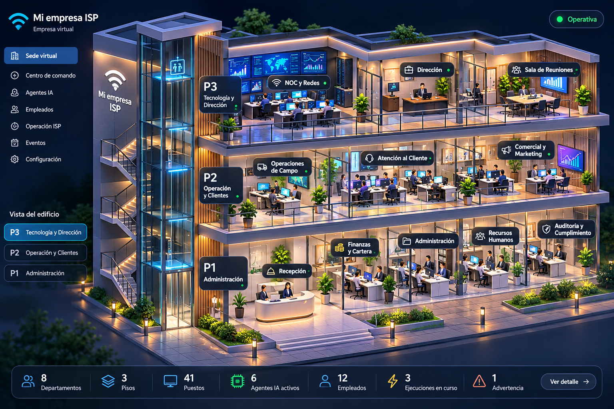

# Objetivo · La sede virtual se reconstruye para que sea un edificio, no una sala

> Abierto el 31/10/2026. Estado: **abierto** — en evaluación de motor gráfico.
> Fase siguiente de [empresa-virtual-isp.md](empresa-virtual-isp.md), que sigue
> siendo el contrato del **qué** y del **por qué**. Acá vive una sola pregunta:
> **con qué tecnología se dibuja**, y con qué evidencia se decide.
>
> Rama aislada: `spec/sede-virtual` — se llamó `-3d` hasta el 31/10/2026, y
> el nombre afirmaba una decisión que no está tomada.
> Versión recuperable de lo anterior: tag `sede-pixi-2026-10-31` → `37972d59`.

---

## La regla que gobierna esta fase

Decisión del usuario, 31/10/2026, textual:

> **EL OBJETIVO FINAL TIENE PRIORIDAD SOBRE LA ARQUITECTURA VISUAL ACTUAL.**
> No estás obligado a conservar PixiJS, el compositor de pisos, las geometrías,
> los personajes, los mapas o la distribución existente si mantenerlos impide
> alcanzar la experiencia que buscamos.

Y su límite, igual de explícito:

> Esta libertad de reconstrucción aplica a los componentes necesarios para
> alcanzar el objetivo, principalmente la experiencia visual. Conserva las
> garantías de seguridad, aislamiento multiempresa, eventos verificables,
> permisos, auditoría y protección de datos.

Lo que esto cierra: **«ya está construido» deja de ser un argumento.** Lo que
no cierra: nada de lo que ya funciona del SaaS se sacrifica por la vista.

---

## Qué significa terminado

Un ISP entra al Centro de Mando y ve **su sede**: un edificio de tres niveles
con departamentos conectados por pasillos y ascensor, personal que se mueve, y
agentes cuya actividad en pantalla se puede rastrear hasta el evento del motor
que la causó — con la cámara de un juego de simulación y no de un plano.

Lo que explícitamente **no** se acepta como resultado, por decisión del usuario:
una cadena de oficinas flotantes, aunque alcance buenos fotogramas.

---

## Lo que se midió antes de recomendar nada

Medido el 31/10/2026 sobre `spec/empresa-virtual-isp` (`37972d59`).

```
escena acoplada al motor grafico   4 archivos · 4.311 lineas TS
   de esos, importan pixi.js       4   (montar, oficina, personaje, texturas)
capa de datos y configuracion     28 archivos ·  3.258 lineas JS · 0 importan pixi
pruebas de navegador              18, de las cuales 2 miran el lienzo
rendimiento hoy (ventana al frente)
   edificio   2.353 obj   101 fps
   un piso      601 obj   144 fps
   una sala     293 obj   144 fps
```

**El hallazgo que decide el costo:** el motor gráfico toca **4 archivos de 32**.
Toda la espina —catálogo de 84 herramientas, `Ocupacion.persona`,
`/agentes/acciones`, los `load` del servidor, `FichaDePuesto`, `departamentos.js`,
`plantillas.js`, `sugerencias.js`— es **agnóstica del motor**. Y de las 18
pruebas de navegador, **16 sobreviven intactas** a un cambio de motor: afirman
sobre lo que la pantalla *dice*, no sobre píxeles.

Esa decisión se tomó ayer por otro motivo —una prueba de píxeles se rompe cuando
alguien mueve una planta dos celdas— y es justo lo que hoy hace que
reconstruir sea pagable. Queda congelada abajo.

---

## Qué se conserva y qué se reconstruye

Pedido por el usuario el 31/10/2026: *«Mantén la arquitectura operativa
existente hasta determinar qué componentes gráficos debemos conservar o
reconstruir.»* Esto es esa determinación. **No depende de la referencia
visual**: depende de dónde están los contratos, y eso ya se puede leer.

Medido archivo por archivo, leyendo lo que cada uno declara hacer.

| Módulo | Líneas | Qué es | Veredicto |
|---|---|---|---|
| `adaptador.ts` | 321 | la frontera entre el contrato de datos y la animación; sostiene *«no saber gana siempre»* | **se conserva entero.** No importa el motor gráfico, y es donde vive la regla de frescura |
| `pose.ts` | 258 | la animación como números; las 20 transiciones salen de interpolar, no de escribirlas | **se conserva el contrato.** Un esqueleto en volumen también se anima con números por pieza |
| `paleta.ts` | 243 | los colores de la paleta Fibra del producto, con el contraste medido | **se conserva.** Lo que de verdad se conserva no son los enteros: es el contraste ya medido |
| `camara.ts` | 278 | tres números y `gesto()`, que separa un clic de un arrastre | **se conserva la decisión.** `gesto()` vale en cualquier motor: es el defecto de `setPointerCapture` ya pagado una vez. La transformación cambia sólo si cambia la proyección |
| `montar.ts` | 658 | la única puerta: cuatro verbos y ni una palabra de PixiJS | **se conserva la interfaz, se reescribe el cuerpo.** Tiene **un solo consumidor**: `v2/+page.svelte` |
| `isometria.ts` | 142 | la proyección 2:1, aritmética pura | **depende de la referencia.** Con volumen real la reemplaza la cámara; si la sede se queda en 2.5D se conserva entera |
| `oficina.ts` | 1.880 | suelo, muros, mobiliario y mural: 32 funciones de geometría | **se reconstruye** |
| `personaje.ts` | 349 | una figura sentada de primitivas, articulada por piezas con nombre | **se reconstruye** si hay volumen real; el nombrado de piezas y su contrato con `pose.ts` sobreviven |
| `texturas.ts` | 182 | halos y sombras generadas con `canvas` una vez al montar | **se reconstruye o se descarta**, según el motor |

```
se reconstruye            2.411 lineas   (oficina + personaje + texturas)
sobrevive                 1.900 lineas   (contratos, decisiones y la puerta)
capa de datos             3.258 lineas   intacta, 0 importan el motor grafico
───────────────────────────────────────────────────────────────────────────
el rediseno toca a lo sumo el 32% de centro-mando
```

**Y el reparto no lo invento yo: lo escribió `oficina.ts` el día que nació.** Su
encabezado dice, textual: *«Esto no es arte definitivo. (…) El día que haya
ilustración, lo que se reemplaza es el cuerpo de estas funciones: la rejilla, el
orden de pintado, la cámara y la frontera con los datos no se tocan. Ese reparto
es el verdadero entregable.»* La arquitectura anticipó su propia reconstrucción,
y por eso hoy se puede pagar.

**Lo que esto cierra como pregunta:** ninguna garantía del SaaS está del lado
que se reconstruye. Aislamiento por empresa, permisos, auditoría, eventos
verificables y protección de datos viven en `nucleo/` y en los `load` del
servidor — y el motor gráfico tiene un consumidor, que es una pantalla.

---

## La evaluación de motor

### La desigualdad de oclusión, y lo que de verdad obliga

Está medido, no opinado. En la escena actual un puesto queda tapado por el piso
de arriba cuando:

```
(ALTURA_DE_PISO − z) · 0,8125  ≤  fondo − gy          con ALTURA_DE_PISO = 15
```

**`gx` no aparece en la desigualdad.** Por eso una sala ampliada sólo puede
crecer a lo **ancho**, nunca a lo hondo: a lo hondo desaparece debajo del piso
superior. Eso no es un defecto pendiente de pulir — es lo que *es* una escena
2.5D ordenada por pintor con losas opacas.

**CORRECCIÓN DEL 31/10/2026.** Acá, hasta hoy, este documento decía que
*«no oficinas flotantes» y «2.5D ordenado por pintor» están en conflicto
directo*, y que la salida obligaba a profundidad real. **Es falso, y lo
desmiente el propio código.**

`edificio.js` ya resolvió ese conflicto, y lo hizo *usando* la desigualdad en
vez de escapando de ella: si lo que tapa es la zona de `gx+gy` pequeño —el
fondo—, entonces las salas van **al frente** y la circulación **al fondo**, y lo
que el piso de arriba oculta es el pasillo, que es lo que menos información
lleva. De ahí sale `ALTURA_DE_PISO = 15`, que no es un gusto: con seis, la
prueba de `edificio.test.js` encontró escritorios de los pisos 1 y 2 detrás de
la losa de arriba —agentes trabajando donde nadie los ve, sin error ni aviso—.
Quince deja **1,6 celdas de margen** sobre el caso que manda, que es la placa de
un puesto.

Y el aire que queda entre losas se llena con estructura —el núcleo vertical y
columnas cada seis celdas, que suben sólo hasta donde hay algo que sostener—,
que es, textual en ese archivo, *«lo que distingue un edificio en sección de
tres bandejas flotando»*.

O sea: la referencia del eje 1 **no escapa** de la desigualdad. La cumple —
plantas altas y poco profundas, sección abierta al frente— y por eso se ve
entera. Lo que la separa de nuestra escena no es la profundidad real: es la
composición, la luz y los materiales.

### Las cuatro exigencias del objetivo, contra cada motor

| Exigencia | PixiJS 2.5D hoy | Three.js ortográfico |
|---|---|---|
| **Edificio de 3 pisos que se vea por dentro** | **ya resuelto**: salas al frente, circulación al fondo, y 1,6 celdas de margen medidas. Lo que falta es fachada, cubierta y basamento — composición, no geometría | lo resuelve de otra forma (profundidad + recorte), pero **habría que volver a garantizarlo desde cero** |
| **Personajes con movimiento natural** | hojas de sprites (8 orientaciones × N animaciones × N aspectos) o esqueletos de pago. **No tenemos pipeline de arte ni artista**. Hoy: una figura sentada de primitivas | un `.glb` con rig + clips (reposo, caminar, sentarse, teclear, hablar); el ciclo de caminata viene con el modelo. **Es la ventaja más clara de 3D, y la decide el eje 3** |
| **Iluminación y profundidad de calidad comercial** | cada superficie y cada sombra se calcula a mano — buena parte de las 1.880 líneas de `oficina.ts`, y cada mueble nuevo exige dibujar su sombra. Alcanza para luz coherente; no es obvio que alcance para luz *cálida de interior* contra fondo oscuro | una platina de luces; las sombras salen solas y siguen coherentes cuando el contenido crece |
| **Cámara de simulación** | panear, acercar y aislar un piso: **ya funciona y tiene prueba**. Orbitar, no: el arte existe desde un ángulo | orbitar es un parámetro. **Pero la referencia del eje 1 no muestra giro**, así que todavía nadie pidió esto: lo dirá el eje 6 |

### El caso a favor de quedarse, con su mejor cara

No es despreciable y hay que decirlo: funciona, corre a 101 fps con 2 353
objetos, **no depende de un solo archivo de arte**, y un departamento nuevo no
necesita que nadie modele nada. Eso último es una propiedad real del enfoque
procedural y es lo que hace que la configuración por empresa funcione hoy.

### El riesgo real de 3D, que no se puede tapar

**Es fácil construir 3D que se vea PEOR que un buen 2.5D.** Low-poly sin
materiales y con luces por defecto se ve como una maqueta de arquitecto de 2005.
La calidad comercial en 3D no es gratis: exige dirección de arte (materiales,
luz horneada, post-proceso) y es trabajo que no desaparece, se mueve.

Y lo procedural tampoco desaparece: un edificio configurable por empresa sigue
teniendo que **generarse desde la configuración**, no modelarse a mano. El
problema de composición se traslada, no se resuelve.

### Dónde está la decisión hoy

**El motor NO está decidido, y no lo decide este documento.** Instrucción
expresa del usuario el 31/10/2026: *«la imagen establece el objetivo estético,
no demuestra que debamos utilizar Three.js»*. Tiene razón, y la evaluación
contra el eje 1 va en esa dirección: de los cuatro criterios que hoy fallan,
**ninguno falla por el motor**.

Lo que queda abierto, y con qué se cierra:

| Pregunta | La decide | Estado |
|---|---|---|
| ¿La composición y la luz de la referencia se alcanzan en 2.5D? | reconstruir `oficina.ts` + encuadre, y comparar la captura contra los 8 criterios | **medible sin cambiar de motor** |
| ¿Los personajes y sus animaciones se alcanzan sin pipeline de arte? | la referencia del **eje 3** | falta la referencia |
| ¿La navegación pedida incluye girar el edificio? | la referencia del **eje 6** | falta la referencia |

Sea cual sea la respuesta, el camino arranca igual: `oficina.ts` se reconstruye
en los dos escenarios. Eso quiere decir que **esperar las dos referencias no
cuesta tiempo de trabajo** — el primer tramo es el mismo.

---

## El spike, y sus criterios de muerte

Una rebanada vertical en `spec/sede-virtual`, en una ruta nueva
(`/centro-mando/v3`), **sin tocar v2**: un edificio de 3 niveles generado desde
la configuración real de Rapilink, un departamento amoblado, un personaje
articulado caminando, y la cámara.

Se declara ANTES de construirlo. Si falla uno, el spike no pasa:

| # | Criterio | Se mide con |
|---|---|---|
| S1 | ≥ 50 fps con el edificio completo, 37 puestos y 8 personajes, **ventana al frente** | la cabecera de telemetría, y el foco controlado (ver riesgos) |
| S2 | Los tres niveles legibles a la vez: ningún piso oculta a los ocupantes de otro | captura del edificio completo |
| S3 | Una persona se distingue de un agente IA a escala de conjunto, sin leer el rótulo | captura del edificio completo |
| S4 | La silueta de un personaje caminando se lee como una caminata, no como un deslizamiento | captura en secuencia |
| S5 | El paquete no crece más de **+400 KB gz** sobre hoy | `vite build` y el tamaño real del bundle |
| S6 | Las 18 pruebas de navegador pasan con **a lo sumo 2 afirmaciones** cambiadas (las que miran el lienzo) | la corrida pegada |
| S7 | Ningún recurso en tiempo de ejecución sale a un tercero: modelos y texturas servidos por nosotros | revisión de red del navegador |

**S7 no es estética.** Un CDN de modelos es un tercero que recibe la IP de quien
mira, y la autorización de tratamiento nombra proveedores (CLAUDE.md §5): un
tercero nuevo se resuelve antes de activarse, no después.

---

## Los seis ejes de la referencia

Los fijó el usuario el 31/10/2026, y ordenan tanto las imágenes como la lista
con la que se juzga cada captura. Detalle operativo y carpetas en
[documentos/sede/referencia/LEEME.md](../../documentos/sede/referencia/LEEME.md).

| # | Eje | Qué decide |
|---|---|---|
| 1 | Arquitectura general y los tres pisos | la silueta del edificio y cuánto se ve de cada nivel a la vez |
| 2 | Conexiones: oficinas, pasillos, puertas, núcleo vertical | si la sede es un edificio o un apilado de salas |
| 3 | Personajes, mobiliario y animaciones | el nivel de detalle, y si una caminata se lee como caminata |
| 4 | Iluminación, materiales, profundidad y paleta corporativa | de dónde entra la luz y qué parte de la paleta Fibra sobrevive |
| 5 | Legibilidad de departamentos y estados | cómo se nombra una sala sin tapar la escena |
| 6 | Cámara y navegación | el ángulo, el acercamiento, si gira, y cómo se baja de edificio a sala |

**Los criterios visuales definitivos NO están congelados**, por pedido expreso:
se escriben cuando lleguen las imágenes, uno por eje, como afirmaciones
comprobables mirando una captura. Lo de abajo son los criterios del objetivo,
que es otra cosa: dicen con qué evidencia se cierra, no cómo se ve.

---

## La referencia del eje 1, y qué dice del motor



Aprobada por el usuario el 31/10/2026 como **referencia principal de
composición arquitectónica**. Guardada en
`documentos/sede/referencia/1-arquitectura/`.

**No es una obligación de copiar** muebles, personajes, indicadores ni cifras.
Los números de su pie —41 puestos, 6 agentes, 12 empleados— son **ilustrativos
y no son requisitos de capacidad**: la sede real declara 8 departamentos, 3
pisos y 37 puestos, y ese número sale de la configuración de la empresa.

### Lo que queda congelado de esta referencia

| Elemento | Decisión |
|---|---|
| Arquitectura | edificio compacto de tres pisos, **no** plataformas flotantes |
| Fachada | sección abierta, paredes de vidrio |
| Circulación | escaleras y ascensor **visibles** |
| Iluminación | oficinas cálidas, tecnología azul, fondo oscuro |
| Personajes | 3D estilizado, no pixel art |
| Departamentos | espacios diferenciados y visualmente conectados |
| Navegación | edificio completo → piso → departamento |
| Interfaz | paneles oscuros, información legible, controles discretos |

### Los ocho criterios del eje 1

Los fijó el usuario. Se comprueban mirando una captura.

```
[ ] 1  los pisos forman un UNICO edificio conectado
[ ] 2  las oficinas se ven claramente desde la vista general
[ ] 3  ningun departamento queda oculto permanentemente tras otro piso
[ ] 4  el edificio aprovecha el viewport sin recortarse
[ ] 5  existe un nucleo vertical de circulacion
[ ] 6  se puede aislar cualquier piso y acercarse a una sala
[ ] 7  la cantidad de pisos y departamentos sigue siendo configurable
[ ] 8  el render conserva legibilidad, profundidad e iluminacion
```

**Criterio de adaptación, del usuario:** otro ISP puede tener **un piso y tres
departamentos** mientras Rapilink usa tres pisos y ocho. Ningún criterio de
arriba se cumple a costa del 7.

### La escena ANTES de la reconstrucción, contra esos ocho criterios

> Lo de abajo es la medición del 31/10/2026 **antes** de construir la
> envolvente. Se conserva porque es la línea base contra la que se compara
> todo lo demás. La medición de **después** está en «La matriz de los ocho
> criterios», más abajo.

Medido sobre la captura `p7-1-edificio-final.png` (31/10/2026, 2.353 objetos,
97 fps), no sobre lo que debería verse.

| # | Hoy | Qué falta |
|---|---|---|
| 1 | **NO** | las tres bandejas se leen como losas escalonadas en diagonal: no hay fachada, ni cubierta, ni basamento que las cierre en un volumen |
| 2 | **a medias** | los escritorios están, pero a escala de conjunto son manchas sobre suelo oscuro |
| 3 | **SÍ** | garantizado por construcción, con 1,6 celdas de margen medidas |
| 4 | **NO** | el edificio ocupa ~40% del ancho útil y está descentrado; queda vacío a la izquierda y abajo |
| 5 | **existe, no se lee** | el núcleo está en el código y en la escena, pero del mismo tono que todo lo demás |
| 6 | **SÍ** | ya funciona, y tiene prueba de navegador |
| 7 | **SÍ** | la estructura sale de la configuración de la empresa |
| 8 | **NO** | casi un solo violeta oscuro: sin luz cálida interior, sin contraste entre suelo y mobiliario, y los rótulos flotan sobre el vacío |

```
cumple 3 de 8 · a medias 1 · no cumple 4
```

### Qué dice esto del motor — el veredicto parcial

**Ninguno de los cuatro incumplimientos necesita profundidad real, ni orbitar,
ni una malla articulada.** Son composición (1), encuadre de cámara (4),
material y color (5), y paleta e iluminación (8). Los dos criterios que sí
tocan la geometría profunda —el 3 y el 6— son justamente **los que ya se
cumplen**, y el 3 lo garantiza la aritmética de la proyección con margen medido.

**Con el eje 1 sobre la mesa, cambiar de motor no es lo que falta.** Lo que
falta es reconstruir `oficina.ts` —las 1.880 líneas que el inventario ya marcó
como «se reconstruye»— más el encuadre de la cámara.

> **Y así fue.** Eso es exactamente lo que se hizo el mismo día, y el resultado
> —seis criterios cumplidos, dos parciales, ninguno pendiente por culpa del
> motor— está abajo. Three.js aportaría luz
real (criterio 8) a cambio de **volver a resolver desde cero el criterio 3**,
que hoy sale gratis.

La decisión **sigue abierta**, y se decide donde todavía no hay evidencia: el
eje 3 (personajes y animación) es donde el coste de 2.5D es real —hojas de
sprites para ocho orientaciones, o esqueletos de pago— y el eje 6 dirá si la
navegación pedida incluye girar. Por eso las dos referencias que faltan no son
un trámite: son las que deciden.

---


## La reconstrucción arquitectónica con el motor actual

Autorizada por el usuario el 31/10/2026, con una condición textual: *«no vamos
a conservar PixiJS por comodidad ni cambiar a Three.js por entusiasmo»*. Esto
**no adopta** PixiJS: lo pone a prueba contra la referencia congelada.

### El problema, y por qué no se arreglaba acercando los pisos

Entre la losa de un nivel y la del siguiente hay quince unidades que la
desigualdad de oclusión obliga a dejar, y los muros de una sala miden cuatro.
**Once unidades de aire por planta, tres plantas: casi novecientos píxeles de
nada.** Eso era lo que se leía como bandejas flotando, y bajar la separación
esconde escritorios — ya estaba medido.

Así que lo que cambió no es la distancia entre pisos: es **qué hay** en ella.

### Lo que se construyó

`escena/arquitectura.ts`, módulo nuevo, con las piezas que el edificio no tenía:

| Pieza | Qué resuelve |
|---|---|
| **Basamento** | explanada, zócalo, escalinata y jardineras. El nivel más bajo dejaba de flotar |
| **Fachada de fondo** | cerramiento continuo de suelo a suelo, con machones, vidrio y revestimiento de madera |
| **Extremo** | el paño de vidrio que cierra el volumen por su lado largo |
| **Cubierta** | losa, peto, equipos de clima, jardineras y **lucernarios** |
| **Remate** | la caja del ascensor que sobresale de la azotea |
| **Núcleo acristalado** | reemplaza los muros opacos del núcleo por vidrio con luz dentro y una franja azul por planta |

Y dos piezas de apoyo: `escena/volumen.ts`, con los primitivos que salieron de
`oficina.ts` —**para no copiar el signo de la luz en dos archivos**, que es cómo
termina habiendo una fachada iluminada al revés— y la extensión de cámara que
mide volúmenes en vez de un cubo.

### Dónde puede ir una fachada en una sección isométrica

En el fondo (`gy = 0`) y en el extremo (`gx = ancho`), **nunca en el frente**:
el frente es el corte de la sección, y taparlo es taparlo todo. Es la misma
razón por la que la franja de circulación nunca tuvo muros.

### El atrio: lo que se aprendió mirando

El primer intento pintó esas once unidades como vidrio apagado —*«ahí arriba no
trabaja nadie»*— y en el navegador se vio exactamente eso: **una banda muerta
por planta, tres apiladas**, y el edificio volviendo a parecer bandejas. Lo que
ese hueco es de verdad es un **atrio**, y un atrio de noche se ve encendido.

El hueco que la geometría impone pasó a ser lo que mejor dice «edificio de
oficinas» desde lejos. No se puede quitar; se puede habitar.

### La luz: dentro sube, fuera baja

La paleta era índigo oscuro de arriba abajo, con su motivo escrito: un centro de
operaciones es un sitio oscuro. Lo sigue siendo —**los racks no subieron**, que
es lo que mantiene al NOC distinto de administración— pero el conjunto pedía
otra cosa: oficinas encendidas vistas desde una noche azul.

Suben suelos, muros y mobiliario. Baja el fondo. **No se subió el brillo de
todo**, que es lo que aplana y lo que el usuario pidió explícitamente no hacer.

### Tres defectos propios, cazados midiendo

1. **Un 500 en la pantalla.** Las piezas de arquitectura nacieron sin `puestos`
   —una fachada no tiene puestos—. La pantalla hace
   `plantas.flatMap((p) => p.puestos)` y `flatMap` **no aplana un `undefined`:
   lo mete en la lista**. El error no salta ahí; salta tres `$derived` más
   tarde buscando `.id`, con una traza que apunta a una línea sin relación.
   Guarda nueva que afirma sobre el efecto: que aplanar no deje huecos.

2. **Un dato que mentía.** Un piso más ancho encima dejaba `sostenidaHasta` por
   encima del propio frente de la fachada. El dibujo lo recortaba igual, así que
   no se veía: lo que quedaba mal era el dato, y un dato que miente es el que se
   cree la siguiente persona. Lo encontró la prueba de configurabilidad.

3. **Un botón de «Encuadrar» que no hacía nada.** El suelo del zoom era un
   número fijo; al aislar el piso de cinco salas el encuadre necesitaba bajar de
   él, el núcleo quedaba cortado y pulsar el botón no cambiaba nada porque la
   cámara ya estaba donde podía. Ahora el suelo se deriva: *no bajar de 0,4,
   salvo que haga falta para ver el conjunto*.

### La envolvente no está escrita para ocho departamentos en tres pisos

Seis pruebas con otras formas, que es lo que separa una sede configurable de una
sede que se ve bien con la empresa piloto:

```
un piso con tres departamentos        remate completo, cubierta sobre ese nivel
tres pisos y ocho departamentos       una fachada y un extremo por piso
la fachada sostenida                  sube hasta la losa de arriba, y no mas
un departamento VACIO                 sigue teniendo su sala y sus puestos
una sala agrandada                    fachada, extremo y cubierta crecen LO MISMO
un piso aislado                       sin explanada ni azotea: se mira por dentro
```

### La matriz de los ocho criterios

Medida en el navegador el 31/10/2026, no deducida del código. Las capturas
están en `.playwright-mcp/` (`v1-edificio-completo`, `v2-piso-aislado`,
`v3-noc-ampliado`, `v4-ficha-agente`).

| # | Criterio | Estado | Evidencia |
|---|---|---|---|
| 1 | Los pisos forman un **único edificio conectado** | **CUMPLIDO** | `v1`: basamento con explanada, fachada continua de suelo a suelo, cubierta con peto, núcleo y columnas. Ya no hay tres losas sueltas |
| 2 | Las oficinas se ven claramente desde la vista general | **CUMPLIDO** | `v1`: las nueve salas con su mobiliario y sus rótulos |
| 3 | Ningún departamento queda oculto permanentemente | **CUMPLIDO** | Dos suites que invierten la proyección punto por punto: losas de nivel y, nueva, la envolvente. Con guarda de la guarda — una cubierta bajada a propósito SÍ acusa |
| 4 | El edificio aprovecha el viewport sin recortarse | **CUMPLIDO** | `v1` y `v2`. Era un defecto real en el piso aislado: el suelo del zoom impedía el encuadre y «Encuadrar» no hacía nada. Arreglado y con prueba |
| 5 | Existe un **núcleo vertical de circulación** | **CUMPLIDO** (en la segunda pasada) | Primero quedó parcial, y lo que faltaba **no era luz**: eran las caras que miran al espectador. Se dibujaban sólo las del fondo, y una caja sin su cara frontal no es un volumen, es un hueco entre dos muros. Con su piel de vidrio por delante —pintada DESPUÉS de la escalera y del ascensor— se lee como torre. Verificado en `v6-nucleo-de-cerca.png` |
| 6 | Se puede aislar un piso y acercarse a una sala | **CUMPLIDO** | `v2` (piso), `v3` (sala), `v4` (ficha abierta por enlace directo) |
| 7 | Pisos y departamentos siguen siendo configurables | **CUMPLIDO** | Seis pruebas con **otras formas**: un piso con tres departamentos, uno vacío, una sala agrandada, un piso aislado |
| 8 | Legibilidad, profundidad e iluminación | **PARCIAL** | Salto grande: interiores encendidos, atrio, lucernarios, cantos de losa claros, luz de luminaria cálida y un filo azul recorriendo cada forjado. La gente ya se lee de lejos con los marcadores de presencia, y los rótulos de piso dejaron de pisarse con los de sala. **Lo que no se cierra** es la proporción: el edificio es una franja larga y no un bloque, y eso es estructural |

```
linea base de esa mañana    cumplidos 3 · a medias 1 · incumplidos 4
tras la primera pasada      cumplidos 6 · parciales 2 · incumplidos 0
tras cerrar los parciales   cumplidos 7 · parciales 1 · incumplidos 0
```

El único que sigue parcial es el **8**, y su parte irreducible está en «La
limitación estructural»: el edificio es una franja larga porque la oclusión no
deja meter dos filas de salas en un nivel. Lo demás del 8 —interiores cálidos,
filo azul en cada forjado, rótulos que ya no se pisan— está hecho.

### La comparación con la referencia, sin suavizar

Lo que la sede **ya tiene** y antes no: volumen cerrado con basamento, fachada y
cubierta; sección abierta al frente; vidrio con montantes; interiores
encendidos sobre noche azul; núcleo acristalado con su remate; azotea con
lucernarios, equipos y jardineras; explanada con setos y balizas.

Lo que **todavía la separa** de la imagen aprobada:

| Diferencia | Por qué |
|---|---|
| El núcleo no domina la composición | En la referencia la torre de escaleras y ascensor ocupa el tercio izquierdo. Acá mide 6×4 celdas sobre un frente de ~58 |
| El conjunto es más frío y más oscuro | La referencia tiene suelos casi blancos; acá son gris lila. Subir más obliga a revisar el contraste de todo el mobiliario |
| Los personajes no se leen a escala de edificio | Diez píxeles por figura. No se arregla agrandándolos: a escala de sala quedarían gigantes |
| El edificio es una franja larga, no un bloque | Cinco salas en fila en P1. Es consecuencia de la oclusión: la profundidad de un nivel está acotada y no caben dos filas |

**Ninguna de las cuatro es un defecto de PixiJS.** Tres son composición y
paleta. La cuarta —la franja larga— sí es estructural y se analiza abajo.

### La limitación estructural, con su aritmética

Un punto de un nivel queda tapado por el nivel de arriba cuando
`gy + (H − z)·0,8125 ≤ fondo_de_arriba`. Despejando para que el escritorio más
retrasado de una sala se vea:

```
H > z_placa + (P − d) / 0,8125
```

con `P` la profundidad de la sala y `d` la distancia del puesto a su muro de
fondo. Con `P = 10` y `d = 2,4`: **H > 12,75**, y está en 15.

De ahí salen las dos consecuencias que se ven en la captura:

1. **Un nivel no puede tener dos filas de salas.** Dos filas piden `P ≈ 28` y
   entonces `H > 28,7`: el edificio se vuelve una torre de 86 unidades. Por eso
   los ocho departamentos van en fila y el edificio es largo.
2. **Entre el techo de una planta (4) y la losa de arriba (15) hay once
   unidades de aire.** No se pueden quitar. Se habitaron: son el atrio.

**Qué haría Three.js distinto, y qué costaría.** Con buffer de profundidad el
piso de arriba no tapa: se oculta o se recorta por cámara, y entonces `H` lo
decide la arquitectura (≈5) y no la aritmética. El edificio sería compacto y
sin atrio forzado. A cambio hay que **volver a garantizar desde cero** lo que
hoy sale gratis —que ningún puesto quede oculto— y resolver materiales, luz
horneada y post-proceso, que es donde un 3D mal dirigido se ve peor que un buen
2.5D.

**La decisión sigue sin tomarse**, y el eje 3 —personajes y animación— es donde
de verdad se decide: es la única diferencia de las cuatro que el motor explica.

### Rendimiento, medido con la ventana al frente

El agujero de medición anterior está cerrado: `page.bringToFront()` de
Playwright trae la ventana y elimina el estrangulamiento de `requestAnimationFrame`.

| Vista | Objetos | fps |
|---|---|---|
| El edificio | 2.397 | **144 · mín 144** |
| Un piso | 1.003 | **144 · mín 144** |
| Una sala | 333 | **144 · mín 144** |

Ni un fotograma por debajo del refresco de la pantalla, con un 2% más de
objetos que antes de la reconstrucción (2.353 → 2.397). **El rendimiento no es
el límite de este trabajo.**

Y el dato de método, que vale más que los números: sin `bringToFront()` la
misma escena marcaba **10 fps**, y `document.visibilityState` decía `visible` y
`hasFocus()` decía `true`. Toda medición de fotogramas de este repositorio pasa
por ahí a partir de ahora.

---

## Los personajes: lo que se arregló antes de tocar el dibujo

El encargo decía *«movimientos naturales, no figuras rígidas que cambian de
postura bruscamente»*. Antes de dibujar nada mejor, había un defecto de sistema
que explicaba buena parte de esa sensación.

### Treinta y siete personas respiraban a la vez

`poseDe(animacion, t)` es una función pura del estado y del tiempo, y
`Transicion.avanzar(dt, t)` recibía el tiempo **global**. Todos los personajes
en el mismo estado devolvían la misma pose **al píxel**: respirando, girando la
cabeza y tecleando al unísono.

El movimiento de cada figura ya era orgánico —las frecuencias se eligieron no
redondas justamente para que respiración y mirada nunca se sincronicen—. Lo que
no era orgánico era **el conjunto**.

Ahora cada persona lleva su reloj: un desfase y un tempo derivados del
**asiento**, no de `Math.random()`. La escena tiene que verse igual en dos
cargas seguidas, o una captura deja de poder compararse con la anterior. El
tempo varía un ±8% y no más: por encima de eso alguien teclea al doble que su
vecino y se lee como un error de reproducción.

Medido: de 37 asientos, al menos 28 caen en posturas distintas. Y 1,37 y 0,37
no son redondos a propósito — con un paso entero los desfases se repiten cada
pocos asientos y vuelven a aparecer filas enteras sincronizadas.

### El gesto ambiental, y lo que NO puede ser

Respirar y mirar de lado son continuos, y un cuerpo que sólo hace cosas
continuas se lee como un mecanismo bien hecho, no como alguien sentado. Falta un
movimiento **discreto y poco frecuente**: estirarse en la silla, echarse atrás,
levantar la cabeza, y volver.

**No es actividad, y eso está medido.** El aura y el brillo de pantalla —las dos
señales que dicen que algo está pasando— no se tocan, y hay una prueba que
afirma que su recorrido en reposo es **cero**. Un gesto de ambiente que subiera
el aura estaría afirmando trabajo que nadie hizo. Es la misma regla que prohíbe
dibujar un agente ocupado sin un evento detrás.

Y se mide que sea un gesto y no un tic: ocurre entre el 2% y el 30% del tiempo.

### Lo que queda del encargo de personajes

| Pedido | Estado |
|---|---|
| Trabajar en computadores · reposo · alerta · despacho · desconocido | **ya existía**, con transiciones interpoladas |
| Transiciones suaves | **ya existía**: 20 transiciones por el precio de una |
| Que el conjunto no se mueva al unísono | **hecho** |
| Gestos ambientales discretos | **hecho** |
| Señales de ejecución activa, alertas, desconocido | **ya existía** |
| **Caminar · sentarse · levantarse** | **NO hecho** — y el motivo que di estaba equivocado |

**Por qué caminar no entró, y por qué ese razonamiento era malo.** Escribí que
no había ningún evento del motor que significara «fulano se levantó» y que
dibujarlo sería inventar actividad. **El dueño del producto lo corrigió el
01/11/2026 y tenía razón**: la simulación híbrida ya estaba aprobada, y un
recorrido ambiental no afirma nada sobre el trabajo de nadie.

Confundí **inventar actividad** —decir que alguien atendió a un cliente sin
evidencia— con **mover a alguien**. Lo primero sigue prohibido; lo segundo
nunca lo estuvo. Ver «Corrección a una decisión mía sobre los personajes»,
más abajo, con la regla de procedencia que queda.

Sigue sin hacerse, ahora por una razón de orden y no de principio: construir el
sistema de locomoción antes de decidir el motor sería construirlo dos veces.

---

## Criterios de aceptación del objetivo

| # | Evidencia | Cómo se comprueba |
|---|---|---|
| 1 | El spike cumple S1–S7, o queda escrito cuál falló y qué se decidió | tabla de arriba, con capturas y salidas pegadas |
| 2 | Las imágenes de referencia están puestas y de cada uno de los seis ejes salió su lista legible | los archivos en `documentos/sede/referencia/` + la lista versionada al lado |
| 3 | `cd pruebas-navegador && ./correr.sh` → 18/18 en verde, dos corridas seguidas | salida pegada |
| 4 | `py -3.13 tests/test_nucleo_sin_tenants.py` pasa | salida pegada |
| 5 | La suite de `vitest` de `centro-mando` en verde, y los rojos preexistentes sin crecer (línea base: 62) | salida pegada |
| 6 | Captura comparada v2 ↔ v3 contra la imagen de referencia, ítem por ítem | las dos capturas y la lista |
| 7 | `auditor-independiente` corrió sobre el bloque | sus hallazgos resueltos o anotados con motivo |
| 8 | `SPEC/DEXTER_ESTADO_ACTUAL.md` refleja el cierre | lo escribe la sesión dueña |

**El criterio 6 existe porque el 2 no alcanza solo.** Una imagen de referencia
sin lista legible se juzga con «se parece», y eso no es un criterio. La lista
—niveles legibles, acceso visible entre departamentos, rótulo leíble al nivel de
conjunto, persona distinguible de agente, sombras coherentes— sí.

---

## Restricciones

Las tres permanentes del repositorio:

- **NO push** — push a `fix/integracion-wisphub` es deploy a producción.
- **NO escribir `tenant_config`** sin decirlo: cada guardado parte la medición ON/OFF.
- **NO correr los 56 casos dorados** — `--humo` (~3 min).

Y las propias de esta fase:

- **v2 sigue funcionando hasta que v3 pase el criterio 6.** No se borra la ruta
  anterior para «limpiar»: es la versión recuperable en caliente, además del tag.
- **No se toca `nucleo/`** salvo que haga falta un dato nuevo de configuración —
  y entonces es configuración, no un `if` por empresa (§3.1).
- **La capa de datos no se reescribe de paso.** `departamentos.js`,
  `plantillas.js`, `sugerencias.js`, `edificio.js` y el contrato de
  `/agentes/acciones` se conservan: son lo que hace pagable esta reconstrucción.
- **La arquitectura operativa actual se mantiene intacta** hasta que la
  referencia esté fijada. Pedido textual del usuario, y además es lo
  correcto: el inventario de arriba se escribió leyendo código que sigue
  corriendo, no reconstruyéndolo para ver qué se rompía.
- No se tocan contenedores ajenos ni volúmenes del laboratorio.

---

## Lo que NO se hace, con su motivo

- **No se migra el Centro de Mando v1** (`/centro-mando`, la pantalla radial).
  Es otra pantalla con otro propósito y está en producción.
- **No se construye un editor de planta visual** (arrastrar muebles). Es un
  producto en sí mismo; la configuración por formulario ya resuelve el alcance
  acordado.
- **No se persigue fotorrealismo.** El objetivo dice «videojuego empresarial
  moderno», y eso es dirección de arte estilizada: más barata, más legible a
  escala de conjunto y más honesta con lo que podemos mantener.
- **No se inventa actividad.** Un personaje se mueve porque hay un evento del
  motor detrás, o no se mueve. Animar por ambiente lo que no pasó convierte la
  pantalla en una mentira bonita — es la misma regla que prohíbe mostrar
  acciones que el backend no permite.

---

## Decisiones congeladas en esta fase

1. **La información vive en el DOM; el lienzo la representa.** Encabezados,
   rótulos, pie y ficha son texto real, y el lienzo es una vista de lo mismo.
   Tres razones, y cualquiera alcanza: se puede probar sin mirar píxeles, se
   puede leer con un lector de pantalla, y sobrevive a un cambio de motor —
   medido: 16 de 18 pruebas de navegador no se enteran de con qué se dibuja.

2. **El respaldo de lo anterior es un tag, no una carpeta `v2_old/`.** Una copia
   de archivos en el árbol se desactualiza y nadie sabe si todavía corre.

3. **La guarda de push se pone POR RAMA, y una rama nueva no la hereda.**
   `branch.<rama>.pushRemote` es por rama; el `pre-push` de `.githooks` es el que
   cubre todo. Al abrir `spec/sede-virtual` se puso la primera y se
   **volvió a medir** la segunda desde la rama nueva: destino rama de deploy →
   bloquea; destino propia → pasa.

---

## Bloqueos

| # | Qué | Por qué bloquea |
|---|---|---|
| B1 | **Las imágenes de referencia todavía no llegaron.** Resuelto quién las pone: el usuario, decidido el 31/10/2026. Van a `documentos/sede/referencia/`, clasificadas por los seis ejes | Sin ellas, «calidad comercial» se interpreta cada sesión distinto y no hay contra qué comparar una captura. **Bloquea construir**, por pedido expreso. NO bloquea el inventario (hecho) ni S1–S7, que son técnicos |

Hay material previo sin revisar que puede servir de referencia, sin seguimiento
de git en el árbol principal: `documentos/command-center/oficina-*.png`,
`cc-v3.png`, `estaciones/`, `avatares/`. No se da por buena ninguna sin que el
usuario lo diga.

---

## Riesgos pendientes

| # | Qué | Estado |
|---|---|---|
| R1 | **Medir fotogramas con la ventana tapada da 1 fps y la API de visibilidad no lo delata** (`visibilityState` = `visible`, `hasFocus()` = `true`). Comprobado con una pantalla sin lienzo, que también dio 1 fps | Mitigado: toda medición de S1 exige ventana al frente, y está escrito en el LEEME de la suite |
| R2 | Licencias de modelos y animaciones de terceros | A resolver antes de que un `.glb` entre al repositorio |
| R3 | Vite en este laboratorio sirve módulos viejos tras editar y hay que reiniciarlo; recién reiniciado hay que calentarlo o la suite muere con un error que no señala a nada | Documentado en `pruebas-navegador/LEEME.md` |
| R4 | Un paquete 3D cargado en la ruta equivocada pesa en pantallas que no lo usan | S5 lo mide; la importación va diferida en la ruta de la sede |

---

## El diseño NO se aprobó, y lo que eso corrigió (01/11/2026)

La matriz llegó a **7 de 8** y el dueño del producto **no aprobó el resultado**:

> El edificio continúa siendo demasiado largo, estrecho y lineal respecto a
> nuestra referencia arquitectónica aprobada. **No quiero conservar la
> distribución lineal únicamente porque actualmente cumple las pruebas de
> oclusión.**

Tenía razón, y la frase señala el error exacto: la franja larga nunca fue una
decisión de diseño, era el residuo de una restricción que se dio por
inevitable. Lo que una prueba mide es que el dibujo es consistente, no que la
forma sea la que se quería.

**Lo que se midió a partir de ahí, en [sede-virtual-comparacion-motores.md](sede-virtual-comparacion-motores.md):**
la causa de la franja no es PixiJS, es dibujar siempre los tres pisos. Con la
planta compacta y el piso aislado, la esbeltez baja de **4,85 a 1,05** y la
altura de **48,4 a 21**. El spike de Three.js está construido, medido y
capturado; **la decisión de motor sigue sin tomarse**.

### Corrección a una decisión mía sobre los personajes

Esta ficha decía que caminar no se implementaba porque *«ningún evento del
motor significa que alguien se levantó, y dibujarlo sería inventar actividad»*.
**Eso estaba mal, y el dueño del producto lo corrigió:**

> Ya habíamos aprobado una simulación híbrida. Caminar puede ser una animación
> ambiental, sin afirmar que el agente está realizando una tarea laboral. (…)
> No debemos confundir simulación ambiental con falsificación de actividad.

Confundí dos cosas distintas: **inventar actividad** —afirmar que alguien
atendió a un cliente sin evidencia— y **mover a alguien**. La primera sigue
prohibida; la segunda nunca lo estuvo.

La regla que queda, y que sí es la correcta:

| | Procedencia | Puede aparecer en el historial |
|---|---|---|
| Caminar, sentarse, levantarse, gestos | `ambiente` | **Nunca** |
| Atender, resolver, escalar, ejecutar | un acontecimiento verificable | Sí |

Queda **por implementar**, después de la decisión de motor: construir el
sistema de locomoción dos veces sería tirar la mitad del trabajo.

---

## Bitácora

| Fecha | Qué avanzó | Qué falta | Commit |
|---|---|---|---|
| 01/11/2026 | **El diseño no se aprueba y se construye el spike de Three.js.** Planta compacta en módulo puro (16 pruebas) con la misma `salasDe` de la pantalla: esbeltez **4,85 → 1,05**, alto **48,4 → 21**. Renderizador ortográfico con tres modos —corte por planos, rayos X y aislamiento— que son las tres salidas a la oclusión. Mismos cuatro verbos que la escena de PixiJS, y `rotulos.js` compartido entre los dos motores. **Antes**: arreglado que dos nombres de sala se taparan, y una prueba `.test.ts` que no corría | Verificar S1 y S2 en el navegador: el motor de Docker se cayó antes. Las referencias de los ejes 3 y 6. El movimiento ambiental | f6840261 · este |
| 31/10/2026 | **Cierre de la validación y de los dos parciales.** El núcleo recibe su piel de vidrio por delante —le faltaba la cara frontal, no luz— y pasa a CUMPLIDO. Marcadores de presencia a tamaño de pantalla para que la gente se lea a escala de conjunto. Cada persona con su reloj: 37 poseían la misma postura al píxel. Gesto ambiental que NO toca el aura. Luz de interior cálida, filo azul en cada forjado, rótulos que dejan de pisarse. **7 de 8 cumplidos, 1 parcial** | El criterio 8: el edificio sigue siendo una franja larga, y eso es estructural. Caminar, cuando haya un evento que lo respalde | 4dfe4687 · 09097aff |
| 31/10/2026 | **Reconstrucción arquitectonica con el motor actual, autorizada y hecha.** Basamento, fachada, extremo, cubierta con lucernarios, remate y núcleo acristalado; la luz separada en dos familias; el encuadre midiendo volúmenes y no un cubo. **6 de 8 criterios cumplidos, 2 parciales** (medido en el navegador, no deducido). 144 fps · mín 144 en las tres vistas con `bringToFront()`. Tres defectos propios cazados midiendo | Los dos parciales: el núcleo a escala de conjunto y los personajes. El eje 3 sigue siendo el que decide el motor | 9bb773bf · 894f0402 · 1ffff317 |
| 31/10/2026 | **Primera referencia aprobada (eje 1)** y sus ocho criterios registrados. La escena de hoy cumple 3 de 8. Corregido un párrafo de esta misma ficha que el código desmiente: la desigualdad de oclusión no obliga a 3D, `edificio.js` ya la usó para colocar salas al frente y circulación al fondo | Las referencias de los ejes 3 y 6; son las que deciden el motor | — |
| 31/10/2026 | Los seis ejes de la referencia quedan fijados y la carpeta preparada; **inventario de qué se conserva y qué se reconstruye, medido archivo por archivo**: 2.411 líneas se reconstruyen, 1.900 sobreviven, la capa de datos no se toca, y el motor gráfico tiene un solo consumidor. Ninguna garantía del SaaS está del lado que se reconstruye | Las imágenes. Sin ellas no se construye | — |
| 31/10/2026 | Rama aislada `spec/sede-virtual` + tag recuperable `sede-pixi-2026-10-31`; guarda de push medida desde la rama nueva; acoplamiento medido (4 de 32 archivos; 16 de 18 pruebas agnósticas); evaluación de motor con recomendación y criterios de muerte del spike escritos antes de construirlo | B1: fijar la imagen de referencia. Después: el spike | esta ficha |
